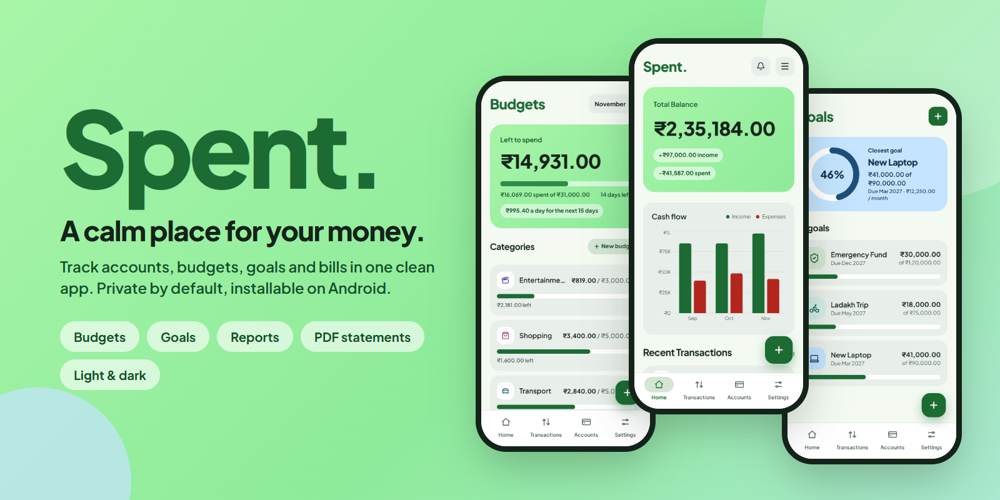
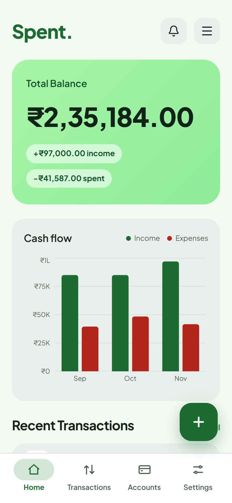
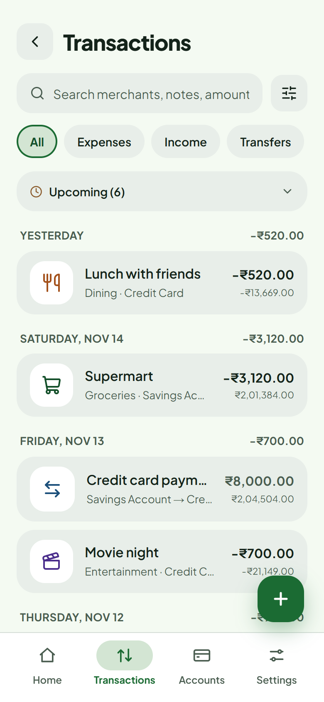
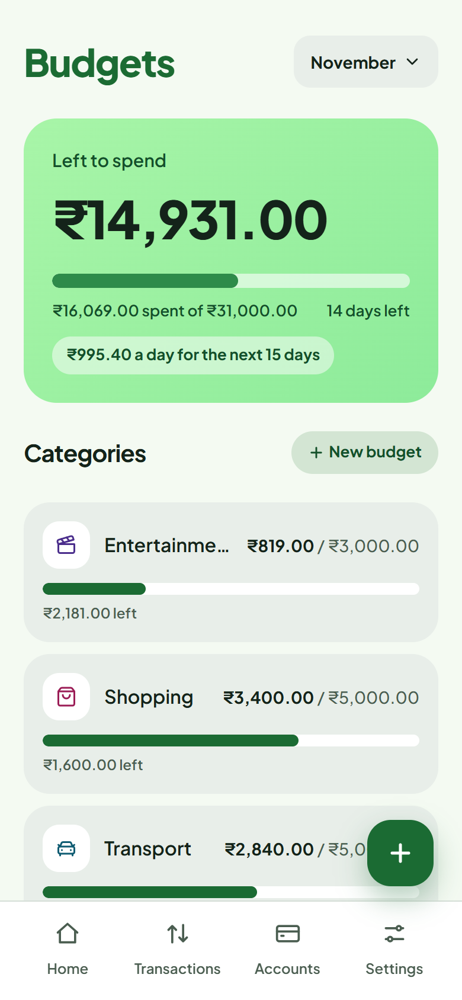
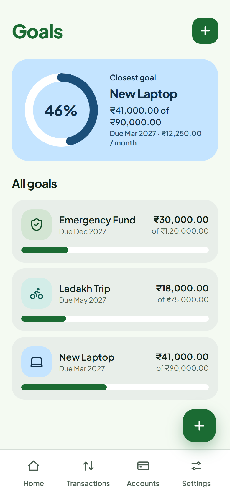
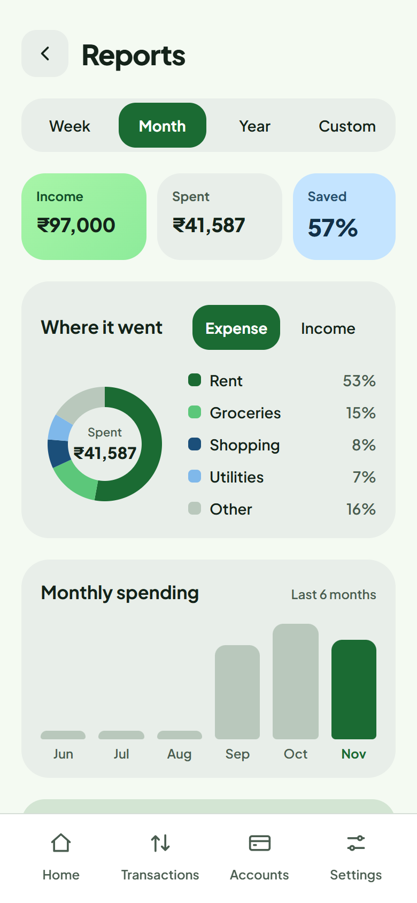
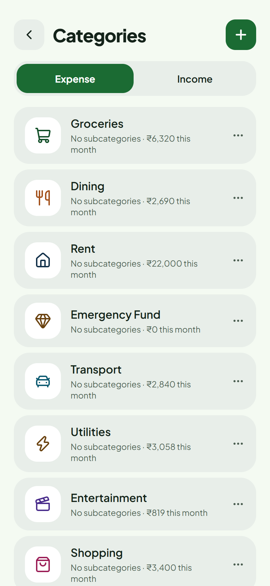
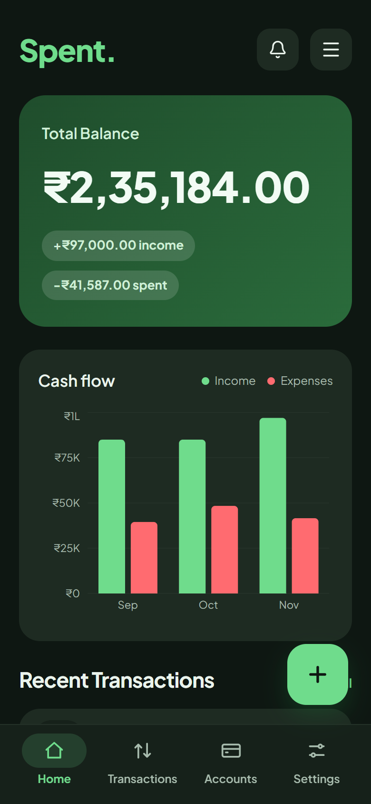
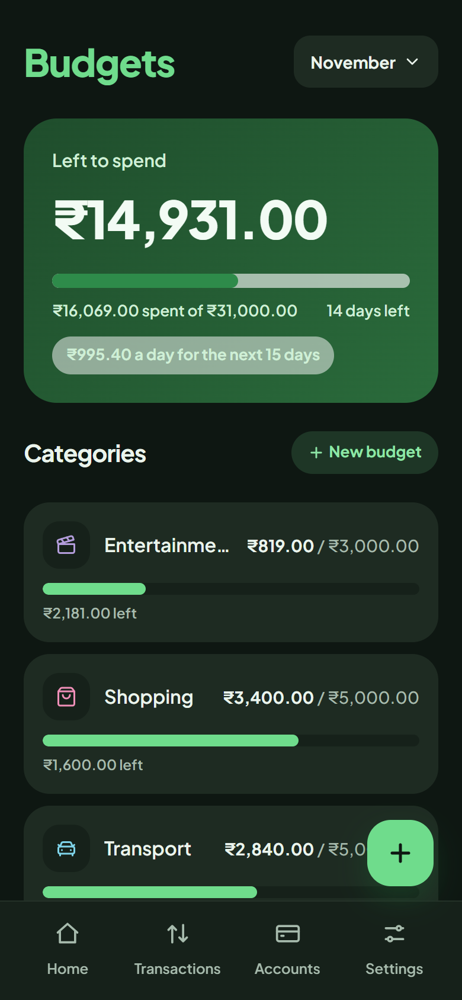
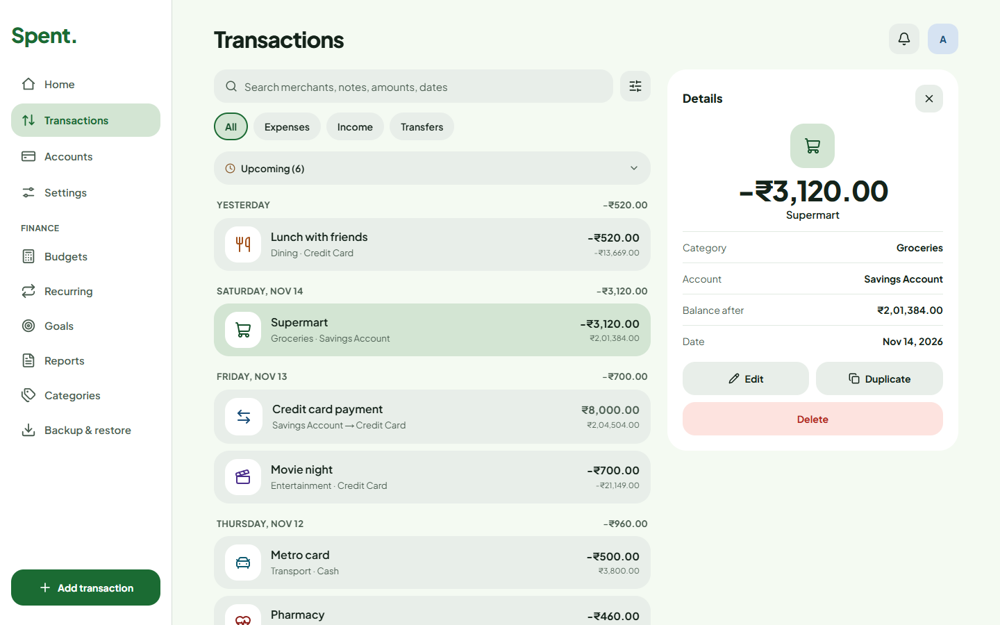

<div align="center">



# Spent.

**A calm personal finance app: accounts, budgets, goals and bills in one place. Private by default.**

[](https://www.spentonline.in)
[](android/README.md)
[](src/lib/changelog.ts)

[](https://nextjs.org)
[](https://www.typescriptlang.org)
[](https://tailwindcss.com)
[](https://www.prisma.io)
[](https://supabase.com)
[](https://vercel.com)


<!-- After the first Android release is published, uncomment these for download counts:
[](https://github.com/gou8m/spent/releases/latest)
[](https://github.com/gou8m/spent/releases)
-->

[Live app](https://www.spentonline.in) · [Android app](android/README.md) · [Roadmap](TODO.md) · [What's new](src/lib/changelog.ts) · [Contact](mailto:help@spentonline.in)

</div>

---

## Why Spent.?

Most money apps either want your bank login or bury you in charts. Spent. is deliberately calm: you record what you spend, and it shows where the money went, what is left this month, and how your goals are coming along. There is no bank linking, no ads and no trackers, only the numbers you enter, kept correct (every amount is stored as an integer in minor units, never a float).

## Features

### Money
- **Accounts** for bank, cash, card and savings, each in its own currency, with credit-limit tracking for cards.
- **Transactions**: expenses, income and transfers (including cross-currency transfers with a live reference rate), with notes, tags, duplicate, and undo after delete.
- **Loans**: track money lent or borrowed, with due dates and part repayments.
- **Recurring bills and subscriptions**, with a "committed each month" total and price-change alerts.
- **Search that understands you**: merchants and notes, but also amounts (`450`), dates (`oct 12`, `last month`) and category names.

### Plan
- **Budgets** (weekly, monthly, yearly or custom) with rollover, an "80% used" warning right in the add sheet, and a per-day figure for the rest of the month.
- **Goals** saved in a specific account: money that arrives there can be marked "for a goal", it stays set aside, and spending from that account warns before it touches goal money.
- **Categories** with subcategories, merge, archive and restore, reorder, a detail view with trends, 270+ searchable icons, one-tap standard categories, and smart suggestions from the merchant name.

### Understand
- **Reports** by week, month, year or custom range: spending by category, monthly trend, drill-down into the matching transactions.
- **PDF statements** for last month, 3 or 6 months, or any date range.
- **Backup and restore** as a single JSON file.
- **Reminders** in the app: bills, loans and holidays a day ahead, plus budget and goal alerts.

### The app experience
- A single design language ("Mint") in **light and dark**, responsive from 320 px phones to ultrawide desktops, with a side details panel on large screens.
- **Installable** (PWA / Android app) with saved pages for slow or offline use, safe-area aware layout, and the phone's Back button closing sheets before leaving a page.
- **Private**: bcrypt-hashed passwords, email verification and password reset, optional Google sign-in, Zod validation on every server action.

## Screenshots

<table>
  <tr>
    <td align="center"><br><sub><b>Home</b></sub></td>
    <td align="center"><br><sub><b>Transactions</b></sub></td>
    <td align="center"><br><sub><b>Budgets</b></sub></td>
    <td align="center"><br><sub><b>Goals</b></sub></td>
  </tr>
  <tr>
    <td align="center"><br><sub><b>Reports</b></sub></td>
    <td align="center"><br><sub><b>Categories</b></sub></td>
    <td align="center"><br><sub><b>Dark mode</b></sub></td>
    <td align="center"><br><sub><b>Dark budgets</b></sub></td>
  </tr>
</table>

<p align="center">
  <br>
  <sub><b>Desktop</b>: transactions with a details panel (the data shown is a demo account)</sub>
</p>

## Download

### Android

> The Android app is being prepared. When the first build is published it will be on the [Releases page](https://github.com/gou8m/spent/releases).

- **Requirements:** Android 6.0 or newer.
- **Install:** download `spent.apk`, open it, and allow installs from your browser once when Android asks.
- **Updates:** the app checks once a day, on the first open, and offers a download. It installs over the existing app (same package and signing key), so you never end up with two copies.
- **How it works:** a thin wrapper opens the live site full screen, so web updates reach the app instantly. See [`android/README.md`](android/README.md) for the build and release guide.

### Web

Open **[www.spentonline.in](https://www.spentonline.in)** and use your browser's "Install app" / "Add to Home screen".

## Tech stack

| Area | Choice |
| --- | --- |
| Framework | [Next.js 16](https://nextjs.org) (App Router, Server Actions), React 19 |
| Language | TypeScript, about 95% of the codebase |
| Styling | Tailwind CSS v4, a custom design system (Plus Jakarta Sans), Radix UI primitives |
| Data | PostgreSQL on Supabase via [Prisma](https://www.prisma.io) 6, with migrations in `prisma/migrations` |
| Auth | Auth.js v5: email and password (bcrypt, JWT sessions) and Google |
| Validation and forms | Zod on every server action, React Hook Form |
| Charts and UI state | Recharts, Zustand, Sonner toasts, Lucide icons |
| PDF and email | PDFKit (statements), Resend (transactional email) |
| Hosting | Vercel |
| Android | Trusted Web Activity (Bubblewrap), service worker for offline pages |

## Getting started

You need Node.js 20+ and a PostgreSQL database (a free [Supabase](https://supabase.com) project works).

```bash
git clone https://github.com/gou8m/spent.git
cd spent
npm install                  # also runs `prisma generate`
cp .env.example .env         # then fill in the values below
npx prisma migrate deploy    # create the tables
npm run dev                  # http://localhost:3000
```

Register an account and you're in: a starter Cash account and a set of default categories are created for you.

### Environment variables

| Variable | Required | What it is |
| --- | --- | --- |
| `DATABASE_URL` | yes | Pooled Postgres connection used at runtime |
| `DIRECT_URL` | yes | Direct Postgres connection used by `prisma migrate` |
| `AUTH_SECRET` | yes | Long random string for signing sessions (`npx auth secret`) |
| `AUTH_GOOGLE_ID`, `AUTH_GOOGLE_SECRET` | no | Enables "Continue with Google" |
| `RESEND_API_KEY` | no | Sends verification and password-reset email. Without it, the links are printed in the server console, which is handy for local development |
| `EMAIL_FROM`, `EMAIL_FROM_NOREPLY`, `EMAIL_FROM_WELCOME`, `EMAIL_REPLY_TO` | no | Sender and reply-to addresses |
| `ANDROID_APK_URL` | no | Where the update prompt links the Android APK (defaults to `/downloads/spent.apk`) |

### Scripts

| Command | What it does |
| --- | --- |
| `npm run dev` | Development server |
| `npm run build` | Production build |
| `npm start` | Serve the production build |
| `npm run lint` | ESLint |

## Project structure

```text
src/
  app/            Routes (App Router): (app)/ for signed-in pages, auth pages, API routes, icons, manifest
  components/     UI by area: dashboard, transactions, budgets, goals, categories, accounts, reports, layout, ui
  actions/        Server actions (every mutation is validated with Zod)
  lib/            Data queries (lib/data), money maths, PDF statement, search parser, icon library
  hooks/ stores/  Small client hooks and Zustand stores
prisma/           schema.prisma and SQL migrations
public/           Service worker (sw.js), offline page
android/          Android app config (twa-manifest.json) and release guide
docs/             README banner and screenshots
```

## Status and roadmap

Spent. is in active development and live at [www.spentonline.in](https://www.spentonline.in). The working backlog, with the history of what shipped and why, is in [`TODO.md`](TODO.md), and user-facing release notes are in the app under Settings, About, What's new. Next up: the Android release and optional automatic Google Drive backups.

## Contributing

Ideas and bug reports are welcome, see [CONTRIBUTING.md](CONTRIBUTING.md). Security issues: please follow [SECURITY.md](SECURITY.md) rather than opening a public issue.

## Acknowledgments

Built with [Next.js](https://nextjs.org), [Prisma](https://www.prisma.io), [Supabase](https://supabase.com), [Vercel](https://vercel.com), [Radix UI](https://www.radix-ui.com), [Recharts](https://recharts.org), [Lucide](https://lucide.dev), [PDFKit](https://pdfkit.org) and [Resend](https://resend.com). Typeface: [Plus Jakarta Sans](https://fonts.google.com/specimen/Plus+Jakarta+Sans) (SIL Open Font License). Exchange-rate reference data from [Frankfurter](https://www.frankfurter.app) (ECB).

## Author

**Goutham Kumar Aare** · [@gou8m](https://github.com/gou8m) · [spentonline.in](https://www.spentonline.in) · [help@spentonline.in](mailto:help@spentonline.in)

## Star history

[](https://star-history.com/#gou8m/spent&Date)
